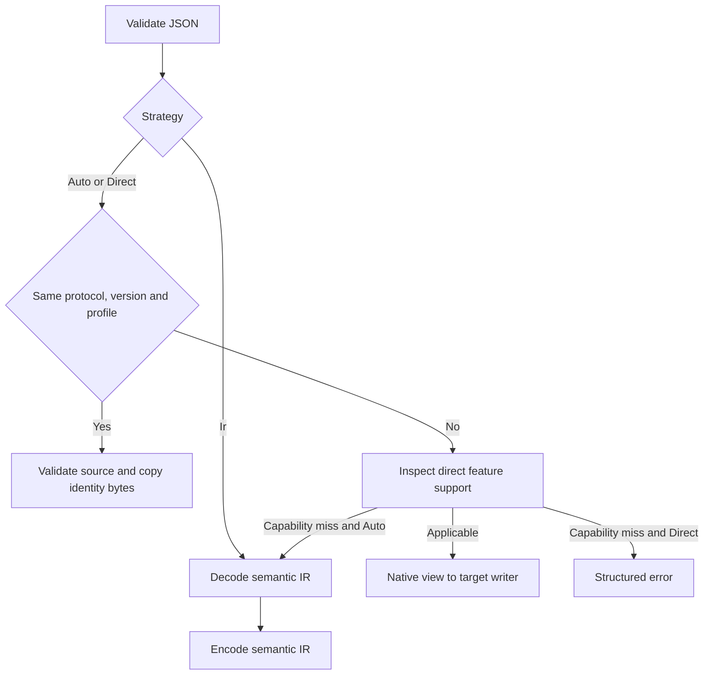

# Architecture and contracts

## Why storage belongs to the caller

A protocol converter must inspect structure, remember stream lifecycle, and write
new syntax. Those operations do not require a heap allocator. zconv borrows
input bytes and asks the caller for each storage region explicitly. An exhausted
region produces a recoverable capacity result rather than allocating a hidden
fallback buffer.

| Layer | Representation | Storage owner | Purpose |
|---|---|---|---|
| JSON | Validated UTF-8 spans and subtree-end token indices | Caller token slice | Complete syntax validation and cheap subtree navigation |
| Native views | `json::Value` over input and token tape | Borrowed | Direct field lookup without owned values |
| Request / response IR | Separate headers and a typed record arena | Caller record slice | Inspection, editing, extension isolation |
| Direct conversion | Native view and JSON writer | Caller output | Avoid semantic arena construction |
| Event IR | Typed events with payload-relative spans | Caller event slice | Explicit streaming IR and edits |
| Stream lifecycle | Converter state and item/checkpoint slices | Caller | IDs, indices, usage, completion, backpressure |
| Aggregation | Append-only linked segments | Caller byte slice | Required complete snapshots and object tool arguments |

The token tape is a compact index, not an owned general-purpose DOM. JSON keys
are sorted through index links solely to detect duplicate decoded names. Original
object order and byte spans remain unchanged. Duplicate detection is bounded by
O(k log k) comparisons for an object with k keys; it does not repeatedly scan
all earlier keys.

## Routing

Only `DirectUnavailable` allows Auto fallback. A syntax error, invalid known
field, policy rejection, missing context, or capacity error never triggers a
second conversion attempt. A Direct capability failure still validates source
semantics before returning, so unsupported fields cannot hide malformed input.
The direct implementation consumes borrowed wire values and never constructs
request/response records. Forced IR always decodes and encodes, including for
identical formats.

Identity validates the complete JSON document and the source adapter's declared
semantic contract before copying bytes. It preserves unknown extension bytes
because the source and target protocol, version and provider profile are equal.

## Lifetimes and editing

A native `Value` borrows both input and the token tape. `RawValue` detaches a
validated fragment: it borrows input only. Request and response IR use detached
fragments, so their token tape can immediately be reused. Text is either a
borrowed JSON string or a caller-supplied UTF-8 replacement. A replacement must
outlive encoding. The caller owns the IR record arena and may inspect or modify
its public semantic fields; encoding validates record ranges and rejects invalid
structure instead of indexing unchecked memory.

Stream event spans borrow the associated payload logically rather than storing
self-referential pointers. `decode_event` writes caller event records;
`stage_events` validates spans and encodes an edited event batch transactionally.
After a stream callback or step advances, callers must not retain a view into a
reused input workspace. Rust's ordinary borrowing rules govern native views.

## Faithfulness and provenance

The default policy rejects unrepresentable semantics. Narrow permissions allow
dropping provider extensions, reasoning, provider context, or nonportable
metadata. Reports distinguish these categories and include metadata field bits;
the IR loss iterator identifies extension names, owner records and source formats.
Tool call IDs, usage, errors, safety/refusal state and context IDs are not generic
metadata that can silently disappear.

An OpenAI previous-response handle and a Gemini previous-interaction handle
belong to different namespaces. The converter never translates their strings
into each other. A caller must materialize the relevant history or explicitly
permit dropping the reference. Provider file IDs obey the same ownership rule.

Gemini GenerateContent carries model selection in a URL and streaming selection
in its method. `EncodeReport.transport_model` and `transport_stream` retain those
facts separately from the JSON body. zconv performs no transport, authentication,
model calls, retries, or server-side resource lookup.

## Numbers and usage

Unmodified numbers retain their original JSON byte spans. Integer token counts
never pass through floating point. Where one provider's accounting differs,
checked integer arithmetic makes the conversion explicit. Anthropic usage
updates are cumulative: a new present counter replaces its prior value. A field
absent from an update retains its last known value. If both canonical input and
output are known, a missing total can be computed with checked addition; counters
that cannot be supplied or derived remain unknown. Repeated updates are not
added together.

## Capacity recovery and output commitment

For nonstream conversion, bytes in the output buffer are provisional until a
successful return. On error discard them. `OutputTooSmall.needed` is exact after
counting the complete output. Enlarge the output and retry the same input.
Token/IR capacity errors report the first required capacity as a lower bound.
Increasing that capacity and retrying may reveal a later requirement.

Streaming stages one converted source event before exposing its bytes. A short
output slice drains the pending event over multiple calls. Each step reports
consumed input and written output. Resend only the unconsumed suffix. Capacity
failures roll back semantic state and preserve the framed event; replace the
named caller buffer and resume. Successfully committed output is never replayed.

The path is fixed before the first output. Direct and IR streaming share the
same primitive event semantics: Direct invokes the sink immediately; IR first
materializes the caller event tape. A later unsupported event fails explicitly.

## Resource limits

JSON defaults limit input to 16 MiB, nesting to 64, tokens to 262,144, and object
members to 16,384. The caller may lower these limits. Nesting has an independent
hard ceiling of 64, so passing `usize::MAX` does not disable stack safety. No
core module hides a giant fixed array or performs heap allocation.

`Conversion.resources` reports input and written output separately from reserved
token, IR, scratch and nested-token capacities. `StreamConverter::memory` adds
state size, framing/data/pending capacities, item checkpoints, event IR and
aggregation, with observed high-water counters. Capacity is reported as capacity;
it is not labeled measured peak usage.
